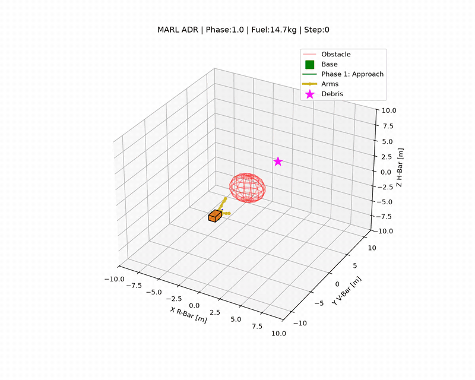
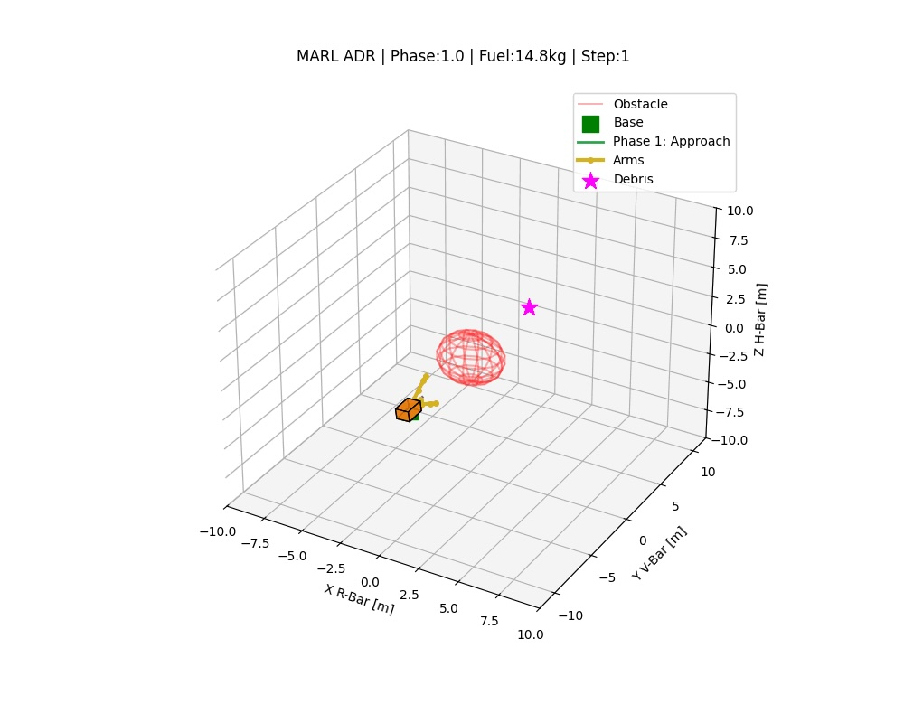
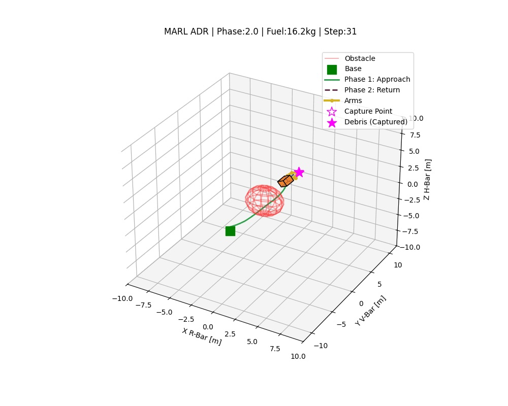
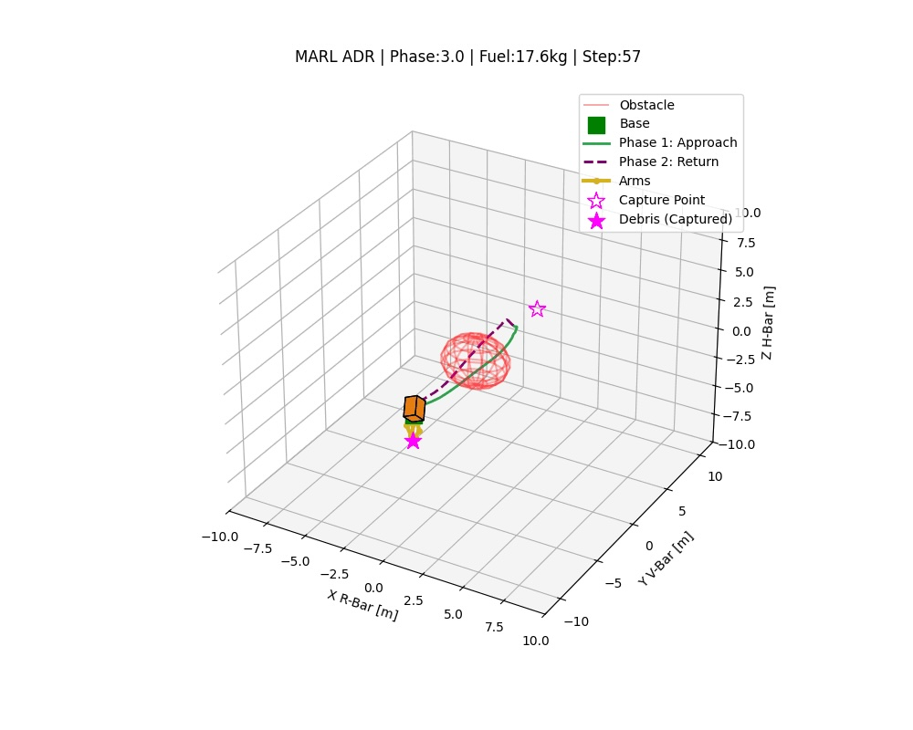
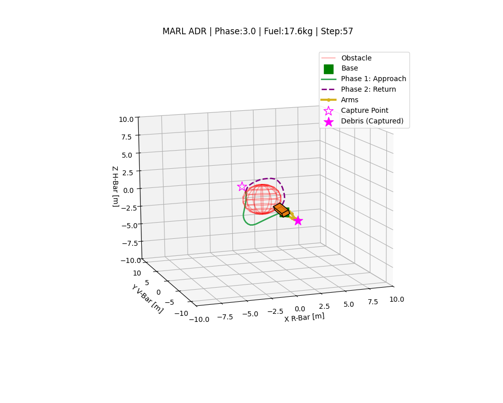
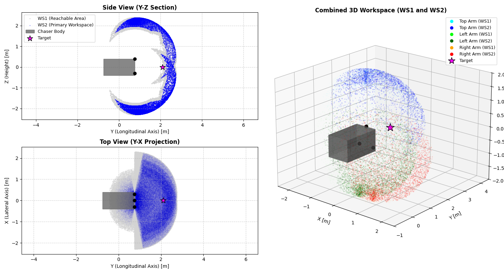
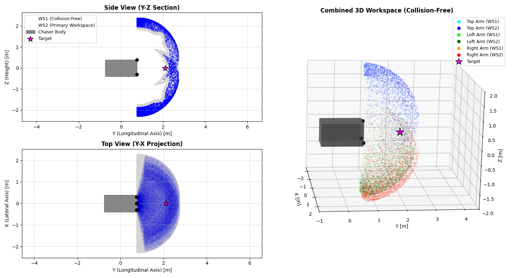

# Multi-Agent Debris Capture & Manipulation

**A Cooperative Multi-Agent Reinforcement Learning (MARL) Framework for Autonomous Orbital Manipulation and Debris Removal**

Two cooperating PPO agents jointly pilot a 6-DOF spacecraft and control 9-DOF robotic arms to autonomously capture orbital debris.

<p align="center"></p>

## The mission

A chaser spacecraft with three 3-DOF robotic arms starts at a base point on V-bar, flies around an obstacle to a hovering point 2.1 m in front of a debris object, holds station while the arms close on the target, and flies the captured debris back to the base. Two agents share the job: a **Pilot** (3 thrusters + 3 reaction wheels) and an **Arm Operator** (9 joint velocities). The arms can move only once the Pilot has held a stable, pointed hover, so the two policies have to cooperate through the mission state rather than through explicit communication.

| Start | Capture | Back at base |
|:---:|:---:|:---:|
|  |  |  |

The mission runs as a finite-state machine: **1.0** approach, **1.5** confirmed hovering (arms enabled), **2.0** capture and return with the debris mass and off-center inertia added to the chaser, **3.0** mission complete.

## Approach

| | |
|---|---|
| **Algorithm** | Independent PPO (IPPO) with round-robin decentralized training: one agent learns while the other acts on its frozen policy |
| **Simulator** | Custom Python 15-DOF physics engine (RK4-integrated Keplerian orbital dynamics, quaternion attitude kinematics, atmospheric drag, gravity-gradient torques, time-variant mass), exposed as a PettingZoo `ParallelEnv` |
| **State & action space** | Pilot: 18-D partial state (POMDP, noisy star-tracker sensing), 6 discrete thruster/wheel channels; Arm Operator: 27-D state, 9 discrete joint-velocity channels across 3 arms |
| **Attitude sensing** | Software-in-the-loop star tracker: TRIAD on Hipparcos stars with Skyfield and the JPL DE421 ephemeris, sun blinding and IMU-drift fallback |
| **Reward design** | Multi-term shaped rewards: navigation, attitude, safety, fuel efficiency for the Pilot; approach, workspace, time for the Arm Operator |

Splitting control across two independently trained policies avoids the non-stationarity collapse of training both jointly.

<p align="center"></p>
<p align="center"><sub>Complete rollout in the LVLH frame: approach (green) around the obstacle, capture, return (purple) to the base.</sub></p>

The arm bases and joint limits were sized with a Monte Carlo workspace analysis, so that the hovering target lies inside the margin-shrunk (dextrous) workspace of all three arms:

<p align="center">
  
  
</p>
<p align="center"><sub>Reachable (WS1) and margin-shrunk (WS2) workspaces of the three arms, without (left) and with (right) collision filtering against the chaser body.</sub></p>

## Results

| Metric | Value |
|---|---|
| Coupled multibody dynamics | 15 DOF (6-DOF spacecraft + 9-DOF arms) |
| Independent PPO policies | 2 (Pilot and Arm Operator) |
| Training steps per agent | 12.1 M+ (per saved checkpoints) |
| Cooperating robotic arms | 3 x 3-DOF |

- Cooperative behavior emerges from shared constraints and coupled rewards, with no explicit agent communication.
- The policy adapts zero-shot to a ~400 kg·m² inertia jump at debris capture (Huygens-Steiner effect).
- The end-to-end mission is trained across sequential FSM phases: approach, hover, capture and return.
- Checkpointed training continued well past initial convergence to further stabilize the harder Arm Operator policy.

## Repository layout

```
adr_marl_env.py         PettingZoo env (pilot + arm_operator), star tracker, IPPO round-robin training, GIF rollout
workspace.py            Monte Carlo kinematic workspace analysis of the three arms
requirements.txt
marl_debris_capture/    trained policies: pilot_latest.zip, arm_operator_latest.zip
graphics/               GIF and figures used above
```

## Running it

```bash
python -m venv .venv && source .venv/bin/activate
pip install -r requirements.txt

python adr_marl_env.py   # round-robin IPPO training, then renders marl_mission.gif
python workspace.py      # kinematic workspace plots
```

`adr_marl_env.py` resumes from the newest checkpoint in `marl_debris_capture/`, so it starts from the trained `pilot_latest.zip` / `arm_operator_latest.zip`. The default `STEPS_PER_ROUND` is small; increase it (and `NUM_ROUNDS`) for real training. On the first run Skyfield downloads `de421.bsp` and the Hipparcos catalog (`hip_main.dat`).

## Context

Sapienza University of Rome, 2026.

**Author:** Federico Falconi · [LinkedIn](https://www.linkedin.com/in/federico-falconi/)
